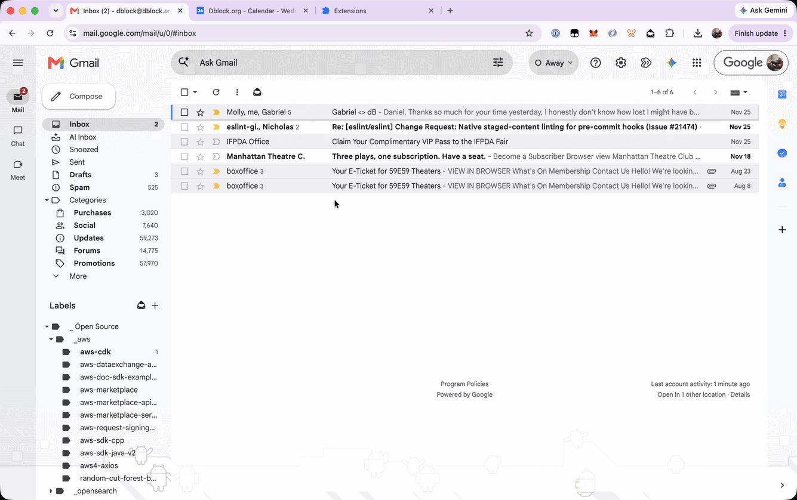

#  Toggle Categories and Labels in GMail

A Chrome extension that toggles (shows or hides) categories and labels that have unread messages in GMail.

## Installation

Install [Toggle Categories and Labels in GMail](https://chromewebstore.google.com/detail/toggle-categories-and-lab/ckejkcopppahbffilefogkmhcgepmnog) from the Chrome Web Store. To build the extension from source instead, see [CONTRIBUTING](CONTRIBUTING.md).

## Usage

Open [GMail](https://mail.google.com) and click the extension's button in the toolbar above the message list to hide categories and labels without unread messages. Click it again to show them. The extension remembers your choice when GMail reloads.

The button appears both in that toolbar and next to the "+" in the sidebar's Labels header. To choose one, click the extension's icon in Chrome's toolbar (or in its Extensions menu) while GMail is open, and pick Message toolbar, Labels header, or Both.

The same menu chooses what the button hides: read labels and categories (the default), read messages in the message list, or both. Hidden messages are only hidden on your screen; nothing in GMail changes.

## Contributing

You're encouraged to contribute to this project. See [CONTRIBUTING](CONTRIBUTING.md) for details, [CHANGELOG](CHANGELOG.md) for what changed in each release, and [RELEASING](RELEASING.md) for how releases are made.

This project was bootstrapped with [Chrome Extension CLI](https://github.com/dutiyesh/chrome-extension-cli) and uses [gmail.js](https://github.com/KartikTalwar/gmail.js) and its [boilerplate](https://github.com/josteink/gmailjs-node-boilerplate). [Unread icons created by Milkghost Studio - Flaticon](https://www.flaticon.com/free-icons/unread).

## License

Copyright (c) Daniel Doubrovkine and Contributors.

This project is licensed under the [MIT License](LICENSE.md).
